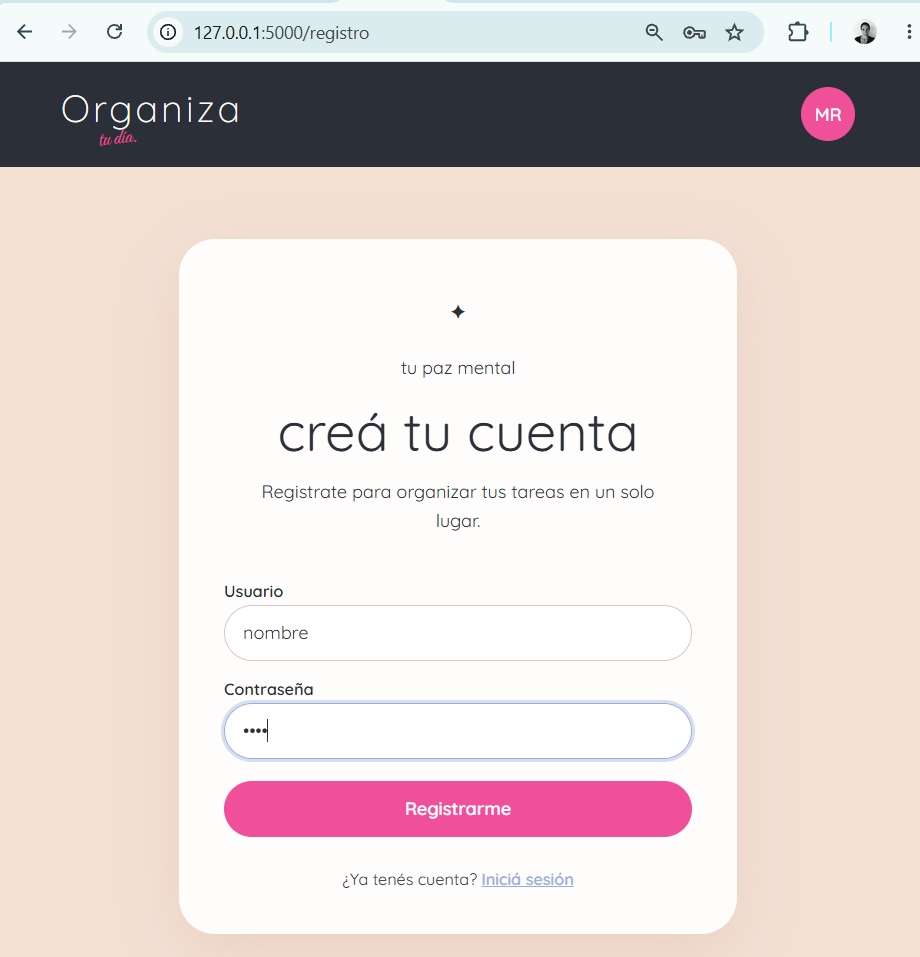
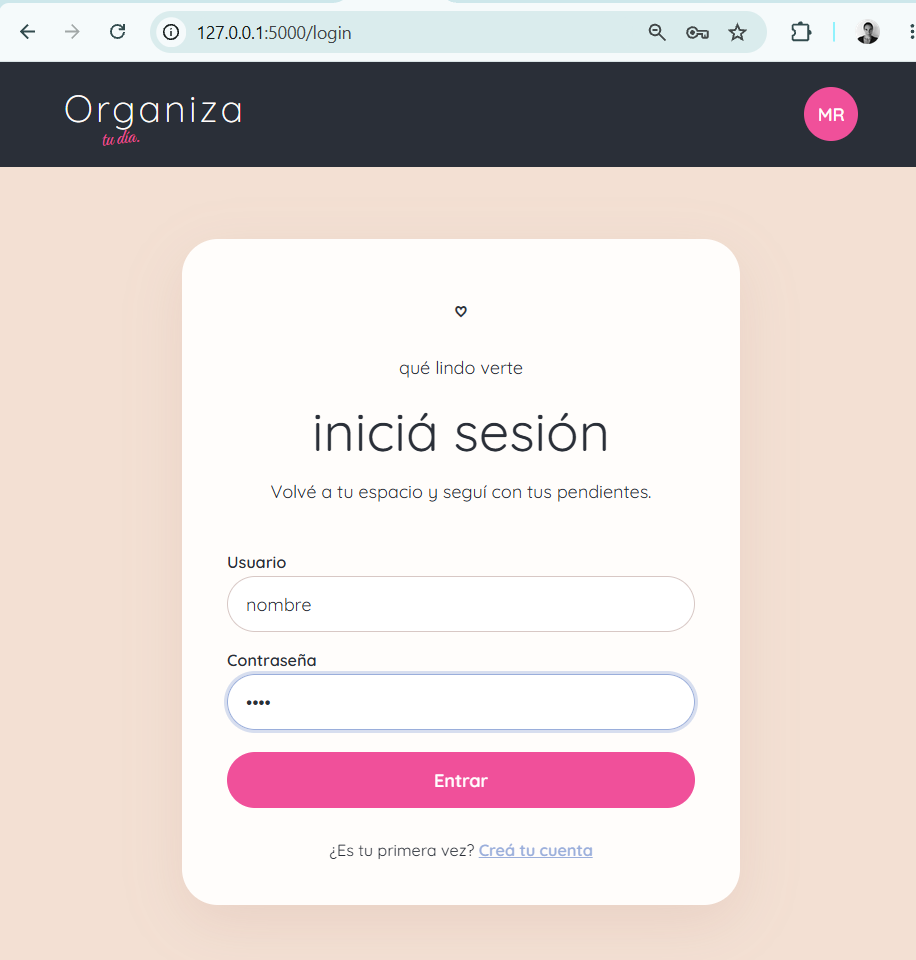
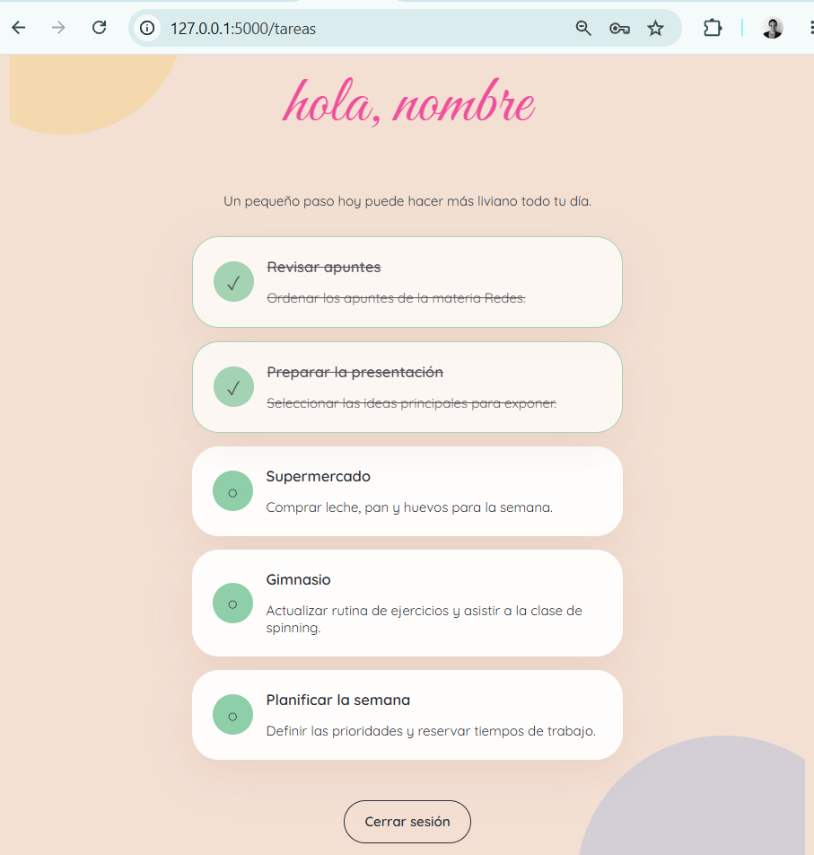
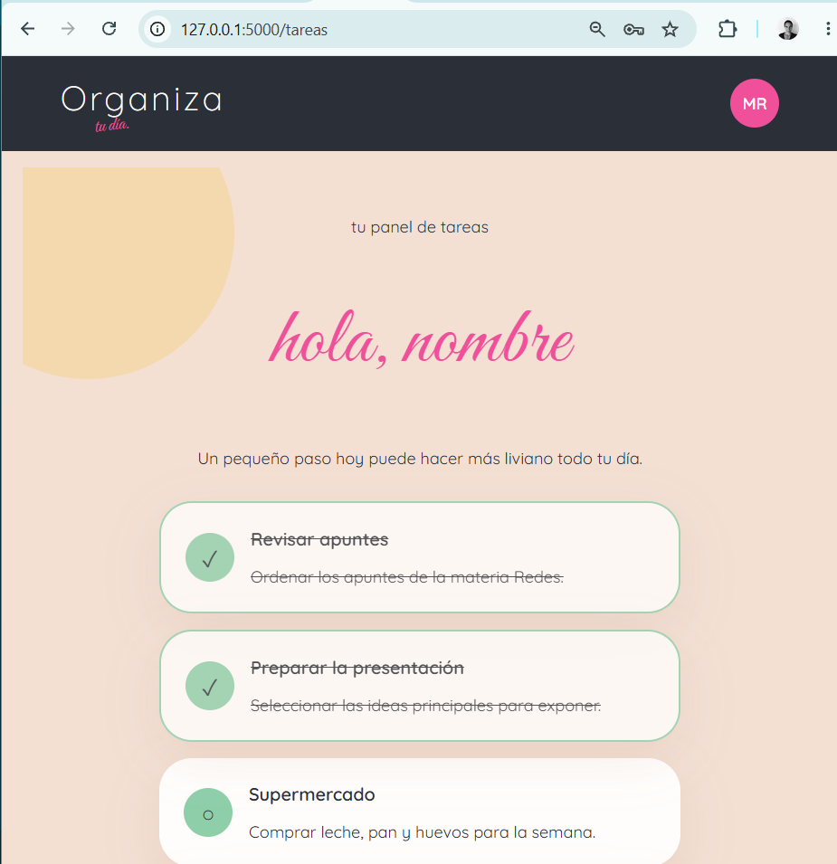

# PFO 2: Sistema de gestión de tareas

Proyecto realizado en Python con Flask, SQLite y un cliente de consola.

## Deploy
[Ir a la página](https://pfo2-redes-ud1f.onrender.com)

## Requisitos

- Python 3.10 o superior.
- `pip`.

## Instalación

Abrir PowerShell dentro de la carpeta `pfo2` y ejecutar:

```powershell
python -m venv .venv
.\.venv\Scripts\Activate.ps1
pip install -r requirements.txt
```


## Ejecutar el servidor

Con el entorno virtual activo, ejecutar:

```powershell
python server.py
```

La aplicación se inicia en:

```text
http://127.0.0.1:5000
```


## Probar desde el navegador

### Registrar un usuario

Abrir:

```text
http://127.0.0.1:5000/registro
```

Completar el formulario con un usuario y una contraseña.

### Iniciar sesión

Abrir:

```text
http://127.0.0.1:5000/login
```

Ingresar los datos registrados. Si el inicio de sesión es correcto, se podrá
acceder a la página de tareas:

```text
http://127.0.0.1:5000/tareas
```

## Usar el cliente de consola

Con el servidor funcionando, abrir otra terminal y ejecutar:

```powershell
python client.py
```

El menú permite:

1. Registrarse.
2. Iniciar sesión.
3. Ver las tareas.
4. Salir.

## Base de datos

La base de datos SQLite se crea automáticamente en el archivo
`database.db`. Allí se guardan los usuarios y las tareas. Las contraseñas se
guardan protegidas mediante hash y no en texto plano.

## Resumen de prueba

1. Ejecutar `python server.py`.
2. Abrir `/registro`.
3. Registrar un usuario.
4. Abrir `/login`.
5. Iniciar sesión.
6. Abrir `/tareas`.
7. Ver las tareas cargadas.

## Capturas de pantalla

### Registro de usuario



### Inicio de sesión



### Listado de tareas



### Listado de tareas detalle



### Respuestas conceptuales
1. ¿Por qué hashear contraseñas?
Hashear contraseñas permite almacenarlas de forma segura, sin guardar el texto original. De esta manera, si alguien accede a la base de datos, no podrá ver directamente las contraseñas de los usuarios. Es una medida importante para proteger la información personal y evitar accesos no autorizados al sistema.


2. Ventajas de usar SQLite en este proyecto
SQLite es una base de datos sencilla de implementar, que no necesita instalar ni configurar un servidor adicional. Almacena la información en un archivo y permite guardar, consultar y modificar datos fácilmente. Para este proyecto es una buena opción porque permite mantener los usuarios registrados de forma persistente, incluso cuando se cierra el servidor, sin agregar demasiada complejidad.